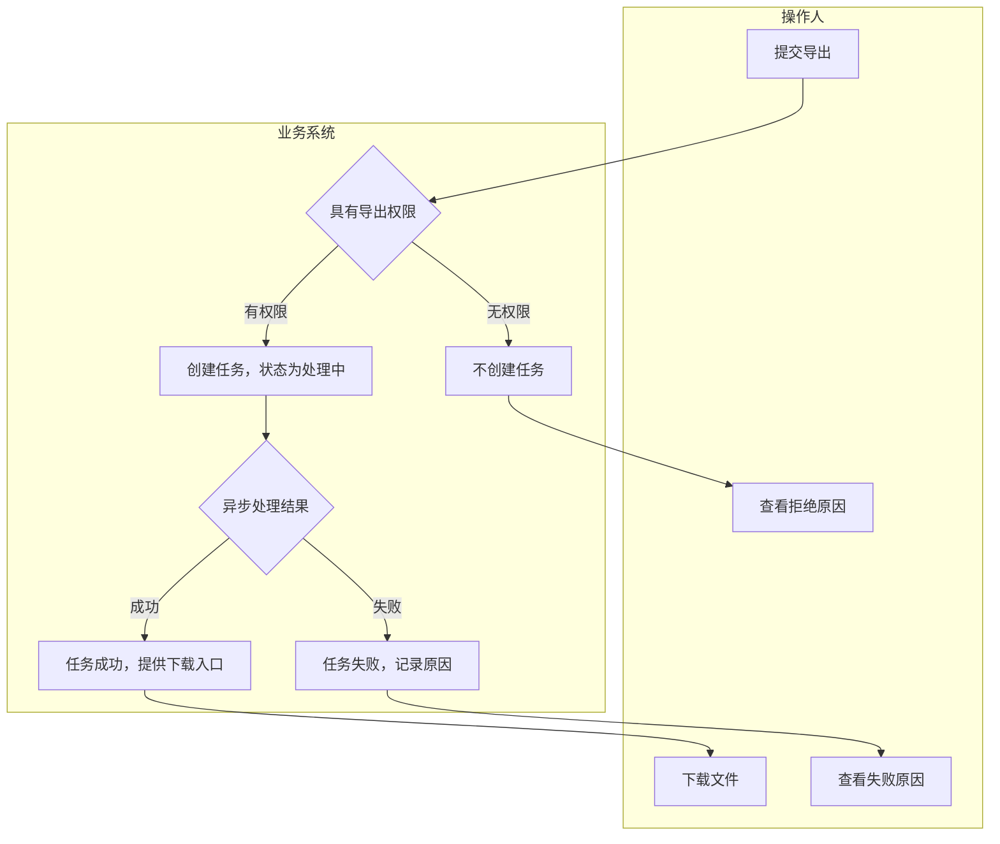
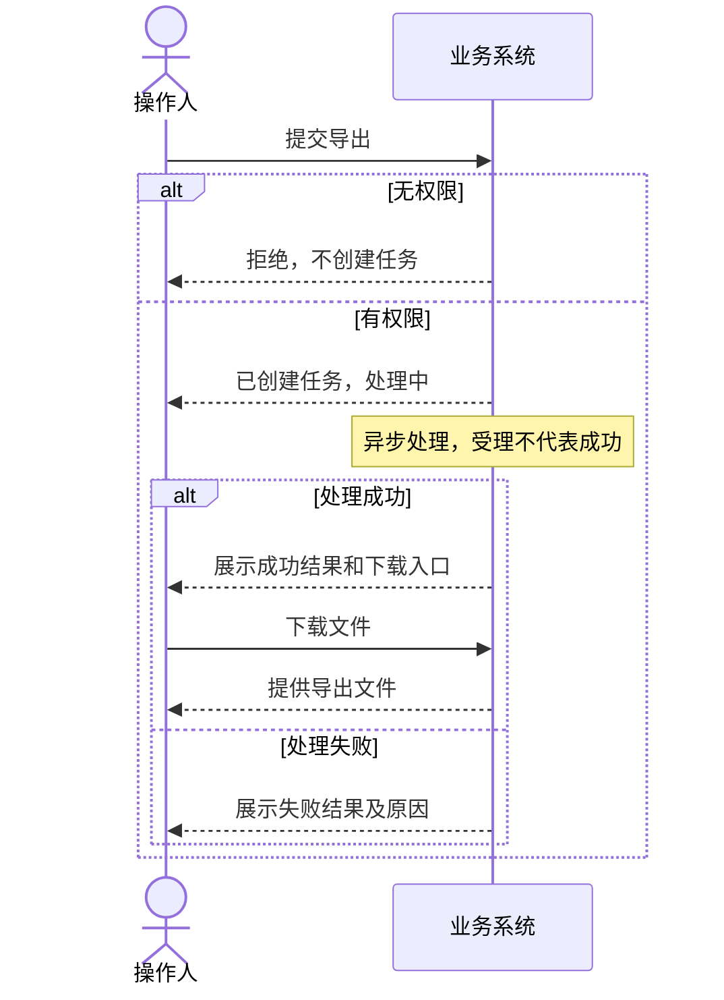
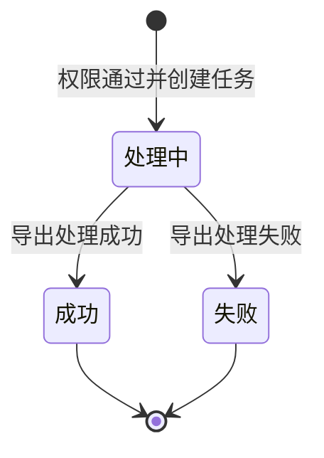

# 业务图示：选型、绘制与验收

图用于评审业务逻辑，不能只展示几个概念及其大致关系。业务事实来自输入 PRD；资料不足处标记「待 PRD 明确」，不得自行添加默认规则。以下示例是假定已确认的独立场景，不是通用业务规则。

## 图种与使用条件

| 图种 | 何时必须提供 | 必须表达 |
|---|---|---|
| 业务流程图 F-xx | 有业务操作流程 | 触发入口、动作归属、系统判断、条件边、成功/拒绝等结果、已定义的返回路径 |
| 泳道/分组流程图 | 上述流程涉及多个角色或责任方 | 动作放入所属泳道，跨角色交接及失败去向清楚；不能仅靠颜色猜责任 |
| 关键时序图 T-xx | 多角色协作、跨端、外部系统或异步任务 | 真实参与方、从上到下的先后、发起与反馈、同步受理与最终完成、影响结果的条件分组 |
| 状态图 S-xx | 对象状态决定可执行动作或页面表现 | 单一对象的初始/终止状态、转换条件、可恢复路径；不混入不同对象的状态 |

时序图按关键场景绘制，不为每个点击画一张；状态图只覆盖业务对象状态，不把页面名当状态。纯静态调整不凑图。其他图种仅在 PRD 明确的对象关系等信息需要评审时补充，不推演技术架构。

## 绘图前先核逻辑

从 PRD 提取触发事件、参与方、前置条件、判断、变化和结果，核对以下问题：

- 不同触发入口是否被错误串成时间链？配置保存、推送发生、用户进入应按实际规则连接。
- 每个判断是否有可理解的条件边和去向？复合条件若导致不同结果，必须拆开表达。
- 拒绝、失败、取消、无资格、已处理等分支是否保留各自的业务结果？返回或重试只画已定义的路径。
- 多角色间谁发起、谁决策、谁执行？异步受理是否被错误当成完成？通知失败是否影响业务结果，以 PRD 为准。
- 同一对象名称、状态与正文/页面一致吗？跨图是否把一个事件画成不同顺序或不同结果？

内部映射须能定位每条影响流程走向、交互顺序或状态的规则。关键缺口会改变主链时先澄清，不能用一条箭头掩盖；局部缺口在图旁明确标记，不画成确定分支。

## 绘制与交付

- 推荐先用 Mermaid 建模，再通过可用渲染工具转为**内联 SVG**；也可直接绘制 SVG，但须保留相同语义。最终 HTML 双击即可看图，不依赖 CDN、网络请求或外部 Mermaid 运行时；不要仅放 Mermaid 源码。
- 流程图用动作矩形、判断菱形及带标签的条件箭头；泳道标责任方。时序图用参与方、生命线、消息箭头和条件/并行区域，不能用横排方框冒充时序图；并行只在 PRD 明确时使用。
- 不设“主链最多 5 个节点”等会删逻辑的限制。过长则按业务阶段或场景拆图，给出同名衔接点及图编号。不要通过缩小字体把所有内容塞进一行。
- 每图使用唯一 id；SVG 的 marker、clipPath 等 id 也须全文件唯一。保留 `viewBox`，预留标签与箭头空间；沿用 `.flow-overview` 的横向滚动，不裁切图示。
- 图表区在设备外壳之外，桌面与移动端原型均适用；每张图有标题、目录入口。实际页面节点可跳转到对应 section，判断和系统节点保持只读。

## 同一业务的三种表达（示例）

假定规则：操作人提交导出；无权限不建任务；有权限创建处理中任务；异步成功后可下载，失败展示原因。示例未定义重试、通知、超时或并发策略，因此不补画。

### F-01 创建与查看导出结果

### T-01 受理与最终结果

消息表达用户可见交互，不暗示使用推送、轮询或其他具体传输实现。

### S-01 单个导出任务

无权限时没有任务，不应出现在任务状态机中；下载是成功后的动作，不是新状态。

## 交付门禁

1. **语义**：对照 PRD 与内部映射逐项检查关键分支、消息顺序和状态转换；正文有而图省略的适用规则须补齐。不能把条件合并成无解释的“资格判断”。
2. **图形**：若使用 Mermaid，实际解析/渲染成功；若手绘 SVG，检查箭头归属、判断标签和时序区域，而非仅统计节点数。
3. **浏览器**：逐张检查整图及复杂分支，文字可读、箭头不穿字、连线有明确起止、无裁切，长图滚动可达；逐个检查可跳转页面节点。
4. **导出**：打开导出的自包含 HTML，图示、分支标签、SVG 箭头及页面锚点完整可用。文案编辑门禁不能代替本项验收。

记录实际检查范围；未完成渲染、浏览器或导出检查时，不宣称图示验收通过。
